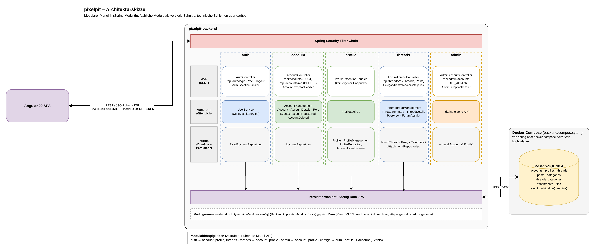
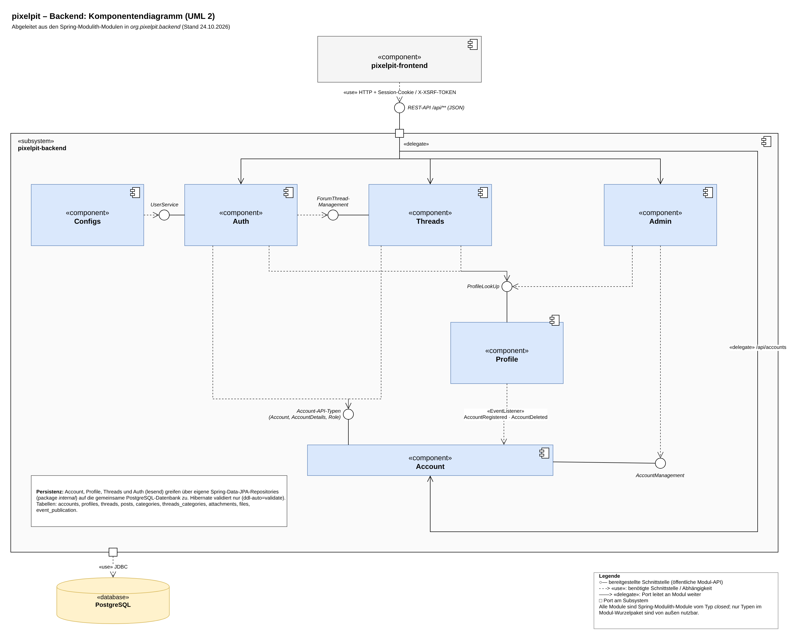

# PixelPit

PixelPit ist ein schlankes Webforum für eine Game-Dev-Community. Mitglieder können Threads eröffnen, darauf antworten und ihre eigenen Beiträge bearbeiten. Administrator:innen vergeben Rollen.

Das Projekt entstand im Rahmen des IU-Kurses **DLBITPEWP01 – Projekt: Einstieg in die Web-Programmierung**.

---

## Aufgabenstellung (kurz)

Ziel ist die Konzeption und Umsetzung eines **einfachen Webforums als MVP**. Die Arbeit folgt diesen aufeinander aufbauenden Schritten:

1. Zielgruppe, Rollen und Zugriffsregeln festlegen
2. Funktionsumfang konkretisieren: Registrierung, Login/Logout sowie Themen und Beiträge erstellen, anzeigen, bearbeiten und löschen
3. Datenschutz und Sicherheit einplanen: Passwort-Hashing, Session-Management, Eingabevalidierung, Schutz vor XSS, CSRF und SQL-Injection
4. UI-Skizzen bzw. Mockups und ein grobes Datenmodell entwerfen
5. Technologien, Datenhaltung sowie Server- und Testumgebung festlegen und begründen
6. Software-Architektur skizzieren und Kriterien für Performance, Wartbarkeit und Sicherheit definieren
7. Auf dieser Basis einen lauffähigen MVP entwickeln

## Funktionsumfang (MVP)

| Rolle | Darf |
|---|---|
| **Gast** | Threads, Beiträge und Kategorien lesen; sich registrieren und anmelden |
| **Nutzer:in** | zusätzlich Threads eröffnen (mit 1–2 Kategorien), antworten, eigene Inhalte bearbeiten und löschen, eigenes Profil ansehen, Konto löschen |
| **Moderator:in** | Rolle ist angelegt, Moderationsrechte folgen in einer späteren Ausbaustufe |
| **Administrator:in** | zusätzlich Benutzerliste einsehen und Rollen vergeben |

Einige fachliche Regeln:
- Ein Thread ist gesperrt, sobald jemand geantwortet hat.
- Gelöschte Inhalte werden nur als gelöscht markiert (Soft Delete).
- Beim Löschen eines Kontos wird das Profil anonymisiert (DSGVO).

## Architektur

Das Backend ist ein **modularer Monolith** auf Basis von Spring Modulith. Jedes fachliche Modul (`auth`, `account`, `profile`, `threads`, `admin`) ist ein vertikaler Schnitt mit Web-Schicht, öffentlicher Modul-API und internem Teil. Die Modulgrenzen werden durch einen Test (`ApplicationModules.verify()`) geprüft.



<details>
<summary>Komponentendiagramm (UML 2) anzeigen</summary>



</details>

Die bearbeitbaren Diagramme liegen als draw.io-Dateien in [`docs/`](docs/):
- `pixelpit-backend-architektur.drawio`: Komponentendiagramm und Architekturskizze
- `uml-use-case.drawio`: Use-Case-Diagramm, Aktivitätsdiagramme, Komponenten- und Klassendiagramm

## Tech-Stack

| Bereich | Technologie |
|---|---|
| Frontend | Angular 22 (Standalone Components, Signals, Signal Forms), Tailwind CSS 4, marked (Markdown) |
| Backend | Java 25, Spring Boot 4.1, Spring Modulith 2.1, Spring Security, Spring Data JPA |
| Datenbank | PostgreSQL 18.4 (Docker Compose), Schema-Migrationen mit Liquibase |
| Sicherheit | Session-Login (HttpOnly-Cookie), CSRF-Token, Argon2-Passwort-Hashing, Bean Validation |
| Tests | JUnit 5 + Testcontainers (Backend), Vitest (Frontend-Unit), Playwright (E2E) |
| Build | Maven Wrapper, Angular CLI / npm |

## Projektstruktur

```
pixelpit/
├── backend/      Spring-Boot-Anwendung (REST-API, Port 8081)
│   ├── src/main/java/org/pixelpit/backend/{auth,account,profile,threads,admin,configs}
│   ├── src/main/resources/db/changelog/   Liquibase-Migrationen
│   ├── db/dev-seed.sql                    optionale Testdaten
│   └── compose.yaml                       PostgreSQL-Container
├── frontend/     Angular-SPA (Port 4200, Proxy /api → 8081)
│   ├── src/app/{core,features,layout,shared}
│   └── e2e/                               Playwright-Tests
├── docs/         Diagramme (draw.io) und Bilder
└── openspec/     Spezifikationen und Änderungsvorschläge (OpenSpec)
```

---

## Setup & Start

### Voraussetzungen

- **JDK 25**
- **Docker** inkl. Docker Compose v2. Docker muss laufen, für den App-Start und für die Tests.
- **Node.js** (aktuelle LTS) und **npm 11**
- Maven muss nicht installiert sein, der Wrapper `./mvnw` ist enthalten.

### 1. Repository klonen

```bash
git clone https://github.com/LR-Argentino/pixelpit.git
cd pixelpit
```

### 2. Backend konfigurieren und starten

```bash
cd backend
cp .env.example .env        # danach POSTGRES_PW in .env auf einen eigenen Wert setzen
./mvnw spring-boot:run      # Windows: mvnw.cmd spring-boot:run
```

Beim Start passiert automatisch Folgendes:
1. Spring Boot startet über `compose.yaml` einen PostgreSQL-Container und wartet auf dessen Healthcheck.
2. Die Datenbankverbindung wird aus dem laufenden Container abgeleitet. Deshalb steht keine Datasource in `application.yaml`.
3. Liquibase legt das Schema an und befüllt die Kategorien.

Das Backend läuft danach unter **http://localhost:8081**.

### 3. Frontend starten

In einem zweiten Terminal:

```bash
cd frontend
npm ci
npm start                   # = ng serve
```

Die Anwendung ist jetzt unter **http://localhost:4200** erreichbar. Anfragen an `/api` leitet der Dev-Server per `proxy.conf.json` an das Backend weiter.

### 4. Optional: Testdaten und Admin-Konto

Beispiel-Threads und -Beiträge laden (die Seed-Nutzer können sich nicht anmelden):

```bash
cd backend
docker exec -i backend-postgres-1 sh -c 'psql -U "$POSTGRES_USER" -d "$POSTGRES_DB"' < db/dev-seed.sql
```

Ein selbst registriertes Konto zum Admin machen:

```bash
docker exec -it backend-postgres-1 sh -c 'psql -U "$POSTGRES_USER" -d "$POSTGRES_DB" \
  -c "UPDATE accounts SET role = '\''ADMIN'\'' WHERE email = '\''du@example.com'\'';"'
```

Danach ab- und wieder anmelden. Der Menüpunkt **Benutzer** erscheint in der Sidebar.

---

## Tests

| Befehl (Ordner) | Was läuft |
|---|---|
| `./mvnw test` (backend) | Unit-Tests und Modulith-Strukturtest |
| `./mvnw verify` (backend) | zusätzlich Integrationstests (`*IT`) gegen PostgreSQL via Testcontainers |
| `npm test` (frontend) | Unit-Tests der Komponenten und Services (Vitest) |
| `npm run e2e` (frontend) | Playwright-E2E-Tests; Backend und Frontend müssen laufen |

## Konfiguration

| Einstellung | Ort | Standard |
|---|---|---|
| DB-Zugangsdaten | `backend/.env` | aus `.env.example` |
| Backend-Port, Session-Timeout, Cookie-Flags | `backend/src/main/resources/application.yaml` | 8081, 30 min, HttpOnly, SameSite=Lax |
| Erlaubte CORS-Origins | `app.cors.*` in `application.yaml` | `http://localhost:4200` |
| API-Proxy im Dev-Server | `frontend/proxy.conf.json` | `/api → http://localhost:8081` |

> **Hinweis für den Produktivbetrieb:** `server.servlet.session.cookie.secure` ist lokal auf `false` gesetzt. In Produktion muss es hinter HTTPS auf `true` stehen.

## Vorgehen

Die Entwicklung erfolgte iterativ in Feature-Branches mit Pull Requests. Jede fachliche Änderung wurde vorab mit [OpenSpec](openspec/) als Vorschlag mit Anforderungen, Design und Aufgaben beschrieben. Nach der Umsetzung wurde sie archiviert.
